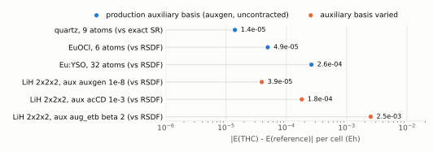
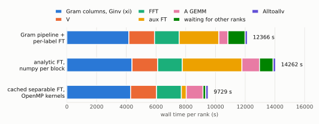
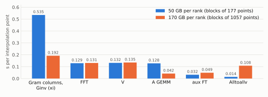

# Gamma-point periodic two-component calculations for all-electron heavy-element crystals: technical report

`socutils.pbc`, state of 2026-11-23.  This is the condensed account: what the code does, how, how well and at
what cost.  The full development record, with every measurement and dead end, is `pbc/DEVELOPMENT.md`; the
results of the Eu runs are in `pbc/HANDOFF_WNSM.md`; usage examples in `examples/pbc/`.

## 1. Summary

* **Purpose.**  Properties at the nucleus of a lanthanide dopant in a crystal (here W_NSM and the 7F0 -> 5D0
  transition dipole of Eu3+), from a CI wave function of the 4f shell embedded in a periodic all-electron,
  two-component (X2CAMF) mean field.  Gamma point; supercells of 6-200 atoms.
* **Two ways to build J and K.**  `RSDF`: a global range-separated density fitting, accurate to its auxiliary
  basis, storage naux x nao^2 / 2 and N^4 exchange.  `THCJK` ("route 1"): no three-index tensor; smooth orbital
  pairs by tensor hypercontraction on a grid, pairs with a compact function by a local fit, built in blocks
  within a memory budget and distributed with MPI.
* **Accuracy of THC against RSDF**: SCF energies 1e-5 to 3e-4 Eh per cell; on Eu:Y2SiO5 (32 atoms) the 7F1
  levels are identical to 0.1 cm^-1, |W| agrees to 0.01% and d00 to 0.1%.  At a site without symmetry the THC
  error of W is ~1% unless the space-group-symmetric grid applies.
* **Cost** (Eu:Y2SiO5 32 atoms): THC on 4 nodes (192 cores) builds in 3 h and takes 150-200 s per SCF cycle;
  RSDF on one node (44 threads) takes ~590 s per cycle with its vectors on disk.  Per core the two are
  comparable; THC is the one that distributes over nodes and does not need the three-index tensor.  Its build
  is the bottleneck and scales with the memory given to each rank.
* **Limits**: Gamma point only; THC needs cells larger than the extent of the basis functions and a large
  auxiliary basis; RSDF is the method of choice while its vectors fit in memory.

## 2. Requirements

| requirement | consequence |
|---|---|
| property at the nucleus, X2CAMF Hamiltonian | all-electron; tight uncontracted s/p primitives up to 1e7-1e8 |
| spin-orbit coupling | two-component spinors, complex densities, Kramers-restricted SCF |
| open 4f shell on a dilute impurity | fractional-occupation SCF -> configuration-averaged HF (CAHF) -> CASCI in the 4f spinors |
| cell-size convergence of the property | 50-200 atoms: the three-index tensor of a global fit no longer fits |

The available periodic tools failed on the first two rows in ways documented in `DEVELOPMENT.md` section 2
(integral screening tuned for smooth functions, auxiliary metrics that turn indefinite for compact functions in
dense lattices, a wrong spin block in the periodic GHF exchange).  Every piece below is therefore validated
against references that do not depend on a periodic code: Madelung constants, a pure reciprocal-space AO
reference, invariances, the molecule-in-a-box limit, and an exactly fittable dense lattice of tight Gaussians
(`pbc/coulomb_reference.py`, `pbc/test/`).

## 3. Method

### 3.1 Kernel and conventions

All Coulomb terms use the periodic kernel without its $G = 0$ component, split at $\omega$:

$$\frac{1}{r} \to \underbrace{\frac{\mathrm{erfc}(\omega r)}{r}}_{\text{real space, images}} +
\underbrace{\frac{4\pi}{G^2} e^{-G^2/4\omega^2}}_{G \neq 0,\ \text{analytic FT}} - \frac{\pi}{\omega^2 V}.$$

Nuclei are Gaussian charges treated as extra auxiliary shells, so $J$, $V_{ne}$ and $E_{nn}$ share one
convention.  The exchange $G = 0$ term is handled as in pyscf's `exxdiv='ewald'`: a constant $-\nu_M N/2$ for an
N-electron wave function, and $K + \nu_M SDS$ in a fractional-occupation mean field, whose density is not
idempotent.  A cell of net charge $q$ additionally needs $q^2\nu_M/2$ (`pbc/charged.py`).

### 3.2 RSDF (`pbc/rsdf.py`, `lib/pbcdf`)

Three-centre and two-centre integrals of the kernel above, fitted in its own metric.  The short-range part is
screened with rigorous pointwise envelopes of the primitives (the smallest of three bounds
$r^l e^{-ar^2} \le c_t\, e^{-t a r^2}$), with auxiliary bounds in both the $L^2$ and the Coulomb measure;
the long-range part comes from analytic pair Fourier transforms.  With `lr='gspace'` only the short-range part
is fitted and the long-range part is kept as exact plane-wave rows.  The Gamma-point spinor SCF reuses the
molecular code with RSDF as its density-fitting object (`spinor_scf.periodic`); Kohn-Sham adds Becke grids
around the atoms and their images (`spinor_ks.periodic_ks`).

### 3.3 Relativity (`spinor_scf.RangeSeparatedX2CAMFHelper`)

$$h = h_{\text{X2C-1e}}[V_{sr}] + (V_{ne} - V_{sr}) + \sum_A \big[h_{\text{AMF}}(A) + d_A\big].$$

The short-range nuclear attraction of all nuclei is decoupled exactly (lattice sum in real space, no background);
the long-range rest is left untransformed like $J$; the atomic mean-field two-electron spin-orbit, Gaunt and
Breit terms are those of the isolated atoms; $d_A$ restores the picture change of each atom's own long-range
part.  A full X2C-1e of the Ewald potential would also transform the neutralizing background, an $O(c^{-2})$,
volume-dependent artefact.  Kr in a box: $E(\text{X2CAMF}) - E(\text{NR})$ equals the atom's to 2.5e-8 Eh.

### 3.4 THC route 1 (`pbc/thc.py`, `thc_local.py`, `thc_gapw.py`, `lib/thc`)

The basis is split at an exponent $\alpha_c$ (default 4): each contracted shell becomes a compact and a smooth
shell, with an exact map to the original basis.  A pair of functions is SS (both smooth) or CX (one compact).

**SS pairs: interpolative separable density fitting on the uniform grid.**

$$\rho_{mn}(\mathbf r) \approx \sum_\mu \xi_\mu(\mathbf r)\,\phi_m(\mathbf r_\mu)\phi_n(\mathbf r_\mu),\qquad
V_{\mu\nu} = (\xi_\mu|\xi_\nu),\qquad
K^{SS}_{ab} = \sum_{\mu\nu} \phi_a(\mathbf r_\mu)\,[\Phi D \Phi^T]_{\mu\nu} V_{\mu\nu}\,\phi_b(\mathbf r_\nu).$$

The $N_\mu$ points (16 per smooth function by default) are the pivots of a Cholesky decomposition of the Gram
matrix $G(\mathbf r, \mathbf r') = (\sum_i \phi_i(\mathbf r)\phi_i(\mathbf r'))^2$ on a coarsened grid;
$\xi = G^{+}_{\mu\mu} G_{\mu \mathbf r}$ by least squares on the full grid; $V$ by FFT.

**CX pairs: local fit.**  The short-range pair density of a compact function $c$ on atom A and a partner on atom
B (within `local_rcut`, 6 A) is fitted with the auxiliary functions of A and B from two-atom cluster integrals;
the partner images beyond the cluster, whose lattice sum is smooth where $c$ lives, are fitted with A's
auxiliary functions on an atomic grid (far-field fit).  The coefficients $C$ are sparse.  Exchange between a CX
and an SS pair uses $A_{P\mu} = (P|\xi_\mu)$, obtained in reciprocal space from the analytic Fourier transform
of the auxiliary functions; between two CX pairs it uses $C^T M C$ (non-robust).  The long-range part of every
block containing a CX pair uses exact plane-wave rows.

**J: no three-centre integrals.**  The smooth density and compensation Gaussians go on the uniform grid (FFT);
the neutral remainder of each atom's compact density is solved by radial Poisson equations on an atomic grid
(GAPW-like).  The pair-local fit is not used for $J$: its residuals add up with one sign (3.6e-3 Eh on quartz).

**What RSDF still provides**: nuclear terms, the $G = 0$ constant and the exact long-range rows of the CX pairs
(`sr_fit=False`, `lr_columns`), and the CASCI integrals $(tu|vw)$ by the three-index route
(`RSDF.active_vectors`: storage naux x ncas^2).

### 3.5 Open-shell route

Fractional-occupation Kramers-restricted SCF with the 4f spinors chosen by character
(`scf/addons.projected_frac_occ` or by projection on reference atomic spinors) -> CAHF with only $J/K$ of the
core and open-shell densities (`mcscf/cahf_fock.py`) -> CASCI(6e, 14 spinors).  In stoichiometric compounds the
other Eu atoms are frozen with their averaged 4f occupation (`mcscf/frozen_frac.py`).  W_NSM is the atomic
operator in the dopant's AO block traced with the core + active density; d00 is taken about the Eu nucleus over
the AO images within a radius (`pbc/atomic_prop.py`).

## 4. Implementation of the THC build

**Point selection.**  Pivoted Cholesky on the grid coarsened 2x per direction (3x only if the factor does not
fit the budget; 3x gave point sets whose energy jumped with the mesh, up to 2.7e-2 Eh on EuOCl).  Blocked, and
distributed over the ranks.  When the cell has space-group symmetry (spglib) the uniform and coarse meshes are
mapped onto themselves by the group and points are chosen in whole orbits, rejecting orbits with a nearly
dependent member; without this the THC factors break the site symmetry (EuOCl: a forbidden W component of 129
against 0.45).

**Streamed build.**  $\xi$ for all points is $N_\mu \times N_{grid}$ numbers (Eu:YSO: 1.4 TB), so the build
runs in blocks $b$ of points:

1. Gram columns on the grid rows, $\xi_b = G^{+}[b]\,G_c$, and in the same pass $V$ of the previous block;
2. FFT of $\xi_b$: columns of $A$, of the long-range rows, and the potential $v * \xi_b$;
3. $V[b] = \int (v * \xi_b)\, G_c^T\, G^{+}$.

$G^{+}$ is applied once to an explicit $\xi_b$; the equivalent $G^{+} Z G^{+}$ loses ~1e-3 Eh to its
conditioning.  The pseudo-inverse cuts relative eigenvalues below 1e-10 (1e-13 amplified BLAS rounding to
7e-5 Eh between thread counts).

**MPI (mpi4py, SPMD).**  The grid is distributed by rows, evaluated once per rank.  Per block: $\xi$ on the own
rows -> transpose to own points on the full grid -> FFT -> transpose of the spectra to own ranges of $G$ for
$A$ -> potential back to own rows for $V$.  The transposes are `Alltoallv` calls in pieces of rows, so no count
exceeds $2^{31}$.  The local-fit coefficients are owned by one rank per auxiliary atom; long-range rows by range
of $G$.  For $A$ the Fourier transform of an auxiliary atom is $e^{-i\mathbf G\cdot\mathbf R_A} B(\mathbf G)$ with
$B = \kappa_l(-i)^l S_{lm}(\mathbf G)\sum_p c_p a_p^{-(l+3/2)} e^{-G^2/4a_p}$; the solid harmonics per $l$ and the
radial factor per shell are cached and multiplied per block by OpenMP kernels.

**Memory.**  Every block size and cache follows `cell.max_memory` (per rank).  The number of blocks is what the
budget buys: each block regenerates the Gram columns of all points.

## 5. Validation

| test | result |
|---|---|
| RSDF against pyscf GDF, same auxiliary basis, LiH 2x2x2 .. 4x4x2 | $E_J$, $E_K$ to 4e-9 Eh |
| RSDF against exact short-range exchange, quartz spinor HF | +2.4e-4 Eh (auxiliary basis) |
| THC route 1 against exact short-range exchange, quartz | -1.4e-5 Eh |
| THC against RSDF, EuOCl primitive (meshes 85 / 88 / 91) | -4.9e-5 / -3.4e-5 / -5.0e-5 Eh |
| streamed against in-core build; MPI against serial | $A$ 6e-10; energies 3e-8 to 4e-7 Eh |
| run-to-run reproducibility (thread count) | ~1e-6 Eh; set `MKL_DYNAMIC=FALSE` |
| GAPW J against RSDF, quartz | max element 4e-6, $E_J$ 2e-6 Eh |
| active $(tu|vw)$, three-index against stored vectors | 1e-15; CASCI levels identical |

*Figure 1.  Error of the THC SCF energy per cell.  With the production auxiliary basis (auxgen, uncontracted,
threshold 1e-8) the error is 1e-5 to 3e-4 Eh.  The local fit of the CX pairs is first order in its error, so
the auxiliary basis matters more than for RSDF (LiH 2x2x2, lower three rows).*

Properties, full pipeline:

| system | quantity | THC | RSDF |
|---|---|---|---|
| EuOCl primitive (symmetric THC) | 7F1 (cm^-1) | 282.5 / 372.4 / 372.4 | 282.6 / 372.3 / 372.3 |
| | W_NSM | (-0.262, 0.454, -3510.4) | (-0.255, 0.445, -3508.6) |
| | d00 | 1.052383e-3 | 1.052370e-3 |
| Eu:Y2SiO5, 32 atoms | SCF / CAHF / CASCI energy | -2.6e-4 Eh, the same shift in all three | |
| | 7F1 (cm^-1) | 186.6 / 403.0 / 478.0 | 186.6 / 403.0 / 478.0 |
| | \|W\| | 4105.0 | 4104.6 |
| | \|d00\| (rc 2.9 A) | 4.003e-4 | 4.00e-4 |

## 6. Cost

Per SCF cycle (all spin blocks of the spinor J and K):

| cell | RSDF | THC | note |
|---|---|---|---|
| quartz, 9 atoms (24 cores, 4 ranks) | - | 2.9 s (K 0.5, J 2.35) | build 102 s; J is the atomic-grid side |
| EuOCl 2x1x1 (48 cores) | 17 s | ~80 s | RSDF vectors 11 GB, in memory |
| EuOCl 2x2x1 (48 cores) | 224 s | 425-435 s | RSDF vectors 88.5 GB; THC peak 489 GB at build |
| Eu:Y2SiO5, 32 atoms | ~590 s (1 node, 44 threads) | 150-200 s (4 nodes x 2 ranks x 24 threads) | not the same resources: ~2.6e4 against ~3e4 core-seconds; THC build 3 h |

The exact long-range rows of the CX pairs scale as $N^4$, like RSDF's exchange.  On one node THC is slower per
cycle than RSDF with its vectors in memory (rows 2 and 3); its advantages are storage, the absence of the
global fit, and that it distributes over nodes, which is what makes the larger cells possible at all.

Build of Eu:Y2SiO5, 32 atoms ($N_\mu$ = 12784, grid 327 x 235 x 181, 13165 auxiliary functions):

*Figure 2.  Streamed V, A on rank 0 of 8 for three versions of the auxiliary Fourier transform.  The analytic
form regenerated in single-threaded numpy for every block was slower than `ft_ao`; caching its separable parts
and assembling them with OpenMP kernels removed that part (2400-5250 -> 256-489 s per rank).  What remains is
dominated by the Gram columns.*

About 70% of the Gram part is the regeneration of the columns of all points in each of the 74 blocks; the
unavoidable part (the two products with $G^{+}$) is ~1300 s per rank.  The number of blocks is set by the memory
per rank:

*Figure 3.  Same cell on 2 large-memory nodes x 4 ranks x 12 threads.  With 170 GB per rank the Gram part falls
to 0.36 of its value at 50 GB (predicted 0.4) and the A GEMM to a third; the whole build goes from 1.05 to
0.70 s per point.  The Alltoallv rate dropped in this run (0.73 against 5.65 GB/s); a transport-only benchmark
does not reproduce it, the cause is open.*

Waiting on other ranks is 180-1150 s per rank but only ~6% of the wall time (stale cost model of the G ranges
~300 s, node speed ~215 s, FFT ~75 s).

## 7. Parameters

| parameter | default | effect, measured |
|---|---|---|
| `alpha_c` | 4 | compact / smooth split |
| `nmu_factor` | 16 | points per smooth function; point-set scatter ~2e-4 Eh on EuOCl at 16 |
| `local_rcut` | 6 A (set it: selects route 1) | with the far-field fit 6 A equals 8 A to 3e-8 Eh; without it 6 A is off by 32 mEh for Eu |
| `omega` | 0.35 | E changes by +3.9e-5 Eh against 0.5 with a third of the long-range rows |
| `isdf_cut` | 1e-10 | thread-count noise 1e-7 instead of 7e-5 Eh |
| `ke_precision` | 1e-12 | the grid carries pair densities: at 1e-10 EuOCl is off by 4.6e-4 Eh |
| `symm_grid`, `symm_pivots` | on if the cell has symmetry | keeps the site symmetry of the THC factors |
| radial grids of the J | Treutler-Ahlrichs 600 (Z <= 18), Mura-Knowles 2000 above | Eu: -1.9e-7 Eh; 600 points give -1e-4 |
| `cell.max_memory` | pyscf's | per rank; decides the number of blocks of the build |
| auxiliary basis | none | large and preferably uncontracted (auxgen 1e-8); acCD works at 2e-4 Eh |

## 8. Limits and known issues

* Gamma point only; no k-points, no gradients.
* THC is for large cells: in a cell much smaller than the extent of the basis functions the smooth pairs are few
  and nearly dependent (LiH primitive cell: 69 points found of 240 asked, 9e-4 Eh).
* On cells where RSDF's vectors fit in memory RSDF is faster per cycle.
* At a site without symmetry the THC error of W is ~1% (the forbidden component of EuOCl computed in P1).
* The THC path is covered by scripts in `pbc/bench/thc_tests/` and by the examples, not yet by unit tests.
* Four errors were found on 2026-11-19 by running small cells of another shape and a contracted auxiliary
  basis (`DEVELOPMENT.md` section 15): the image range of RSDF for cells much longer along a diagonal than along
  the axes (LiH 3x3x3: 0.1 Eh; the Eu cells run so far are far from the condition), the pruning of contracted
  auxiliary shells in the streamed build, translation ranges for non-orthogonal cells, and a crash for small
  bases.  All are fixed in master 3bb6512.
* Open: per-rank budget in production (50 GB used so far of 96 available), the measured fall of the Gram part
  with the number of ranks, the Alltoallv rate in large-memory runs, the spline prefilter of the J on small cells.

## 9. Where things are

| | |
|---|---|
| modules | `pbc/rsdf.py`, `spinor_scf.py`, `spinor_ks.py`, `split_direct.py`, `thc.py`, `thc_local.py`, `thc_gapw.py`, `charged.py`, `atomic_prop.py`, `coulomb_reference.py`; C kernels `lib/pbcdf`, `lib/thc` |
| open-shell machinery | `scf/addons.py`, `mcscf/cahf_fock.py`, `mcscf/frozen_frac.py`, `mcscf/eri_active.py` |
| examples | `examples/pbc/00..05` |
| production driver | `pbc/bench/dopant_casci.py` |
| tests | `pbc/test/` (9 files); THC checks `pbc/bench/thc_tests/` |
| development record | `pbc/DEVELOPMENT.md` (Part I: references, RSDF; Part II: pipeline, THC, build, bugs) |
| results and run paths | `pbc/HANDOFF_WNSM.md` |
| figures | `pbc/report/make_figures.py` |
